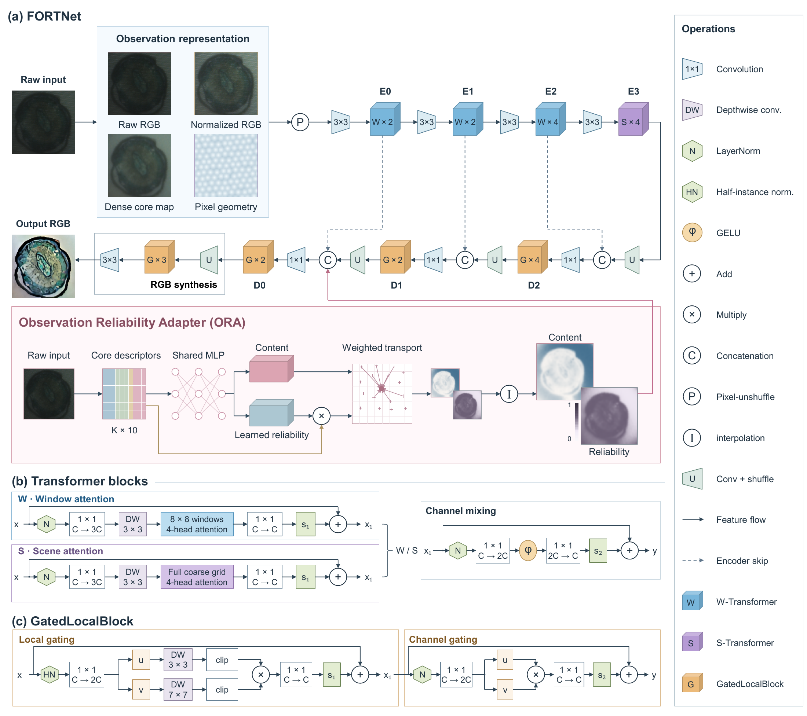

# FORTNet

**Fibre Observation Reliability Transport Network** reconstructs single-frame multi-core fibre (MCF) images under exposure variation.

MCF images contain a discrete fibre-core sampling pattern, while changes in exposure can weaken local contrast, alter colour and clip bright regions. FORTNet combines spatial reconstruction with observation-dependent feature transport to suppress sampling artifacts and recover scene content across nominal, underexposed and overexposed captures.

- **Geometry-aware observation representation:** raw RGB, globally normalized RGB, a dense field interpolated from core measurements and pixel geometry form a 12-channel input. These complementary views retain measured intensity while providing the backbone with spatially connected observations and the fibre sampling structure.
- **Multiscale Transformer reconstruction:** window attention captures local relationships, and scene attention at the coarsest scale models broader image structure. Skip connections, learned upsampling and gated local blocks combine these features before full-resolution RGB synthesis.
- **Observation Reliability Adapter (ORA):** core descriptors encode raw and normalized photometric information, intensity scale and clipping. Learned weights, modulated by clipping and neighbourhood consistency, control geometry-based, normalized transport of core content to the decoder. The resulting content and reliability maps enter the final decoder fusion and share the same RGB output path.

The full model has **20.19 million parameters** and maps one **368 × 368 RGB** MCF frame to a reconstructed RGB image at the same resolution. Inference uses the supplied fixed fibre geometry and does not require an exposure label or multiple input frames.



Architecture figure from the paper. [Vector PDF](docs/fortnet_architecture.pdf).

## Installation

Use Python 3.11. CUDA training requires a GPU with BF16 support; the reference run used an A100 80 GB. Run all commands from the repository root.

```bash
python -m pip install torch==2.11.0 --index-url https://download.pytorch.org/whl/cu128
python -m pip install -r requirements.txt
```

## Dataset

Download **[FORTMCF on Hugging Face](https://huggingface.co/datasets/LoyCeavy11/FORTMCF)**: five real exposure conditions (`dark_025`, `dark_050`, `nominal`, `bright_150`, `bright_200`) and paired `gt`, with 5,200 training, 400 validation and 400 test scenes per condition.

```bash
python download_data.py --output datasets/FORTMCF
```

The script downloads nominal/GT training pairs and all validation/test conditions, verifies the archives and extracts them. For manual downloads, extract all ZIPs into the same dataset root; each already contains `condition/split/*.png`.

## Inference

The trained best weights and [three scenes used in the paper](examples/scenes.json) are included. Try inference without downloading the full dataset:

```bash
python infer.py --input examples/inputs/dark_025 --output outputs/predictions
```

`--input` accepts a PNG or a directory. Use `--device cpu` for CPU inference. Inputs must be **368 × 368 RGB** images matching the supplied fibre geometry. Example inputs, predictions and targets are in [`examples/`](examples/).

## Training

```bash
python train.py --data datasets/FORTMCF --output outputs/fortnet
```

The default protocol uses batch size 8, 100 epochs (65,000 updates), AdamW and cosine learning-rate decay. Nominal/GT pairs are trained with calibrated exposure perturbations; the fixed calibration uses training-split exposure statistics. The best checkpoint is selected by nominal-validation PSNR.

Resume the same run:

```bash
python train.py --data datasets/FORTMCF --output outputs/fortnet --resume outputs/fortnet/latest.pt
```

Checkpoints and `train.log` are saved in the output directory. The bundled `checkpoints/fortnet_best.pt` contains inference weights; resume training from your run's `latest.pt`. Use `--cache-device cpu` to keep the image cache in system memory.

## Evaluation

```bash
python evaluate.py --data datasets/FORTMCF --checkpoint checkpoints/fortnet_best.pt --output outputs/test --save-images
```

This evaluates the same checkpoint on all five real test conditions and saves per-image metrics and predictions. For your own run, use `--checkpoint outputs/fortnet/best.pt`. PSNR and SSIM are computed from float RGB predictions before PNG quantization. Reference results are in [`results/test_metrics.json`](results/test_metrics.json).
