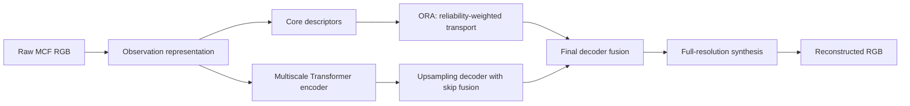
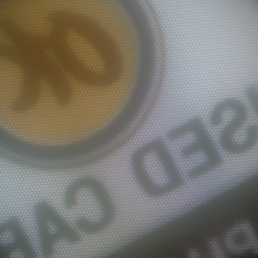
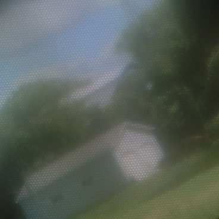

# FORTNet

**Fibre Observation Reliability Transport Network** for single-frame multi-core fibre (MCF) image reconstruction under exposure variation.

This repository contains the full FORTNet model, its trained weights, fixed fibre geometry and exposure calibration, and standalone training, evaluation and inference scripts. The data and weights correspond to native **368 × 368 RGB** measurements from the FORTMCF acquisition system.

## Method

FORTNet combines a geometry-aware observation representation with a multiscale Transformer and an Observation Reliability Adapter (ORA). It has **20,191,409 trainable parameters**.

1. **Observation representation.** Raw RGB, globally normalized RGB, a continuous RGB field interpolated from fibre-core measurements, and three geometry channels form a 12-channel input. A pixel-unshuffle stem maps the observations to the encoder grid.
2. **Multiscale reconstruction.** Window attention operates at 184 × 184, 92 × 92 and 46 × 46; scene attention operates at 23 × 23. Learned upsampling and local gated processing recover full-resolution detail.
3. **Observation reliability transport.** ORA encodes core-level normalized and raw photometric coordinates, global log intensity scale, and clipping fractions. Clipping and neighbourhood consistency modulate learned reliability weights. Geometry-weighted, denominator-normalized transport produces 14 channels that enter the final decoder fusion. A single full-resolution synthesis path predicts RGB.

The reliability terms are observation-derived priors; they are not an exact physical inverse or a calibrated uncertainty estimate. The included geometry is specific to the acquisition setup. Images from another fibre bundle require corresponding geometry and calibration, rather than resizing arbitrary photographs to this input size.



## Installation

The reference environment uses Python 3.11, PyTorch 2.11.0 with CUDA 12.8, NumPy 1.26.4, SciPy 1.17.1 and Pillow 12.2.0. Training was performed on an NVIDIA A100 80 GB. CUDA inference and training use BF16 autocast; CPU inference uses float32 and can differ slightly.

From the repository root, in a Python 3.11 environment:

```bash
python -m pip install torch==2.11.0 --index-url https://download.pytorch.org/whl/cu128
python -m pip install -r requirements.txt
```

An editable installation is optional: `python -m pip install -e .`. It adds the `fortnet-train`, `fortnet-evaluate`, `fortnet-infer` and `fortnet-download` commands. The commands below use the root scripts and do not require an editable installation.

## Quick inference

The repository includes three test scenes used in the paper, their targets, and stored FORTNet predictions. Each scene is supplied at all five exposure conditions. No full dataset download is needed for this command:

```bash
python infer.py --input examples/inputs/dark_025 --output outputs/dark_025
```

For a single image:

```bash
python infer.py --input examples/inputs/nominal/000244.png --output outputs/single
```

Use `--device cpu` for float32 CPU inference or `--batch-size 8` to process multiple images together on a suitable GPU. Input images must be native RGB PNGs with the supplied fibre geometry. Outputs are clipped to [0, 1] and rounded to 8-bit PNG; no per-image brightness or contrast adjustment is applied.

| Scene | Use in the paper |
| --- | --- |
| `000244` — circular sign | Qualitative reconstruction comparison |
| `000370` — toy figures | Qualitative reconstruction comparison |
| `000400` — house and greenery | Acquisition and dataset illustration |

| Scene | Nominal input | FORTNet | Target |
| --- | :---: | :---: | :---: |
| Circular sign |  |  |  |
| Toy figures |  |  |  |
| House and greenery |  |  |  |

The example files preserve the full 368 × 368 frame without crop annotations or display adjustments. The paper's qualitative comparison shows selected exposure conditions and matched crops; the package additionally includes the remaining conditions for the same scenes. These illustrative examples do not replace the full-test evaluation.

## Dataset

**Dataset repository: [LoyCeavy11/FORTMCF on Hugging Face](https://huggingface.co/datasets/LoyCeavy11/FORTMCF).**

The published dataset contains six folders: `nominal`, `dark_025`, `dark_050`, `bright_150`, `bright_200` and `gt`. Each folder provides `train.zip`, `validation.zip` and `test.zip`, with 5,200 / 400 / 400 images respectively. There are 36,000 PNG files across the six folders. The four non-nominal conditions contain **real acquired exposure images**, not synthetically perturbed evaluation inputs.

The downloader pins dataset revision `5d9c39e501b6df66a037165be36c58922cc472f1` and checks the SHA-256 of every archive before extraction:

```bash
python download_data.py --output datasets/FORTMCF
```

By default it downloads nominal and GT for training, and all six folders for validation and test. The real extreme training folders are unnecessary for reproducing neural training with the supplied fixed calibration. Add `--all-exposure-train` only if those additional source data are needed. To download just the test split:

```bash
python download_data.py --output datasets/FORTMCF --splits test
```

For manual downloading, extract every ZIP into the **same dataset root**. The archives already contain the `condition/split/` path. Do not extract them into another nested condition folder.

```text
datasets/FORTMCF/
├── nominal/{train,validation,test}/*.png
├── dark_025/{validation,test}/*.png
├── dark_050/{validation,test}/*.png
├── bright_150/{validation,test}/*.png
├── bright_200/{validation,test}/*.png
└── gt/{train,validation,test}/*.png
```

Pair images by filename **within a split**. Numeric filenames repeat between splits and are not global sample identifiers. No unpublished metadata folder is required. Training and evaluation check image sizes, exact pairing, sample counts and the packaged per-file SHA-256 manifest.

## Training

Start a new full training run:

```bash
python train.py --data datasets/FORTMCF --output outputs/fortnet
```

The reference configuration is:

| Setting | Value |
| --- | --- |
| Neural training data | 5,200 nominal input–GT pairs |
| Native resolution | 368 × 368 RGB; no random crop or resize |
| Batch size | 8 paired samples |
| Duration | 100 epochs, 650 updates per epoch, 65,000 updates total |
| Optimizer | AdamW; betas (0.9, 0.999), epsilon 1e-8, weight decay 0 |
| Learning rate | Cosine decay from 2e-4 toward 2e-6 over 65,000 updates |
| Loss | 0.75 × nominal L1 + 0.25 × synthetic-exposure L1 |
| Update | Separate weighted backward passes, one optimizer step |
| Gradient clipping | Global norm 1.0 |
| Precision | BF16 autocast, float32 loss and selected normalization operations |
| Selection | Highest mean nominal-validation PSNR, evaluated each epoch |

Training starts from random initialization. Predictions are **not clipped before the training loss**. The sample permutation generator persists across epochs; the checkpoint stores the global update, optimizer, random states and sample-order digest. The initial module construction order is retained to reproduce the reference seeded initialization.

Only `nominal/train` and `gt/train` images enter neural optimization. Exposure perturbations are generated on the fly from the nominal inputs. Half of the gain draws use the four anchors 0.25, 0.5, 1.5 and 2.0; half are log-uniform draws between 0.25 and 2.0. The simulator interpolates calibrated RGB response curves in log exposure, applies 8-bit quantization, and adds calibrated intensity-dependent correlated residuals at the two exact dark anchors.

The supplied calibration was estimated from **training-split exposure statistics** (384 fitting identities and 128 statistical holdout identities), without validation or test data. Real extreme images are not directly used as neural training samples. Consequently, this protocol uses nominal-only neural training inputs but should not be described as having no access to real extreme training statistics. Geometry and response parameters are fixed during neural training.

The default caches decoded uint8 training pairs on the GPU. Use `--cache-device cpu` when GPU memory is limited; this preserves the samples and update equations but adds host-to-device transfers. The original batch and full model require substantially more memory than inference.

### Resume and logs

```bash
python train.py --data datasets/FORTMCF --output outputs/fortnet --resume outputs/fortnet/latest.pt
```

`latest.pt` and `best.pt` contain complete training states; the resume command continues from **the run directory's `latest.pt`** and verifies its selected `best.pt`. Move the whole run directory together when changing its location. An interruption between writing a new latest checkpoint and its matching best checkpoint is recovered on resume. The included `checkpoints/fortnet_best.pt` is a compact **inference checkpoint** and cannot be used as a training resume file. Resume with the same training configuration, data subset and implementation. Sample order is reconstructed and checked before continuing.

The trainer writes `outputs/fortnet/train.log`, with step progress and an epoch-end validation summary. It keeps `latest.pt` at each epoch boundary, every 650 updates, and at a requested stop. A hard interruption resumes from the last saved update. Adjust `--save-every` for more frequent checkpoints.

Monitor in Linux/macOS:

```bash
tail -f outputs/fortnet/train.log
```

Monitor in PowerShell:

```powershell
Get-Content outputs/fortnet/train.log -Tail 30 -Wait
```

`--stop-after-updates 650` pauses after the first epoch without shortening the fixed learning-rate schedule. Test evaluation is a separate reporting command and does not select checkpoints or affect optimization.

## Evaluation and visualization

Evaluate the supplied best checkpoint on all five real test conditions:

```bash
python evaluate.py --data datasets/FORTMCF --checkpoint checkpoints/fortnet_best.pt --output outputs/test --save-images
```

For a new training run, replace the checkpoint path with `outputs/fortnet/best.pt`. The same nominal-validation-selected checkpoint is used for every exposure condition. Each condition contains all 400 test images.

Metrics are averaged per image from float predictions clipped to [0, 1], before PNG quantization. PSNR uses RGB mean-squared error with a unit data range. SSIM uses float64 RGB computation, an 11 × 11 Gaussian window with sigma 1.5, valid convolution and constants 0.01² / 0.03². There is no border crop before PSNR, no luminance-only conversion, and no image-specific tone correction. The reference evaluation uses batch size 8 and BF16 CUDA inference. Hardware, precision or batch-size changes can produce small numerical differences.

The reference best was selected at epoch 65 (update 42,250) from the 100-epoch run:

| Test condition | PSNR (dB) | SSIM |
| --- | ---: | ---: |
| Nominal | 22.4137 | 0.612488 |
| Dark 0.25 | 21.9880 | 0.561306 |
| Dark 0.50 | 21.9857 | 0.590123 |
| Bright 1.50 | 21.9659 | 0.618400 |
| Bright 2.00 | 21.7371 | 0.617117 |

Machine-readable reference results and the distributed checkpoint checksum are in [`results/test_metrics.json`](results/test_metrics.json). They are archived full-test results, not metrics computed from the three included examples. The PNG examples are for visual inspection; recomputing metrics from them does not reproduce the float benchmark.

## Repository contents

```text
fortnet/          Model, exposure simulator, training and evaluation implementation
fortnet/assets/   Fibre geometry, fixed calibration and dataset checksums
configs/          Reference training configuration
checkpoints/      Compact trained best weights
examples/         Three paper scenes, five-condition predictions and targets
results/          Reference full-test metrics
tests/            Numerical and checkpoint protocol checks
```

Full datasets, training optimizer archives and third-party baseline implementations are not bundled. Runtime dependencies are listed in `requirements.txt`.

Run the protocol tests after installing pytest:

```bash
python -m pip install pytest
python -m pytest -q
```

The included checkpoint is about 97.8 MiB. Use a Git client to push the repository; it exceeds GitHub's browser-upload limit while remaining below its [100 MiB per-file Git limit](https://docs.github.com/en/repositories/working-with-files/managing-large-files/about-large-files-on-github). No account credentials or machine-specific paths are required by the code.
